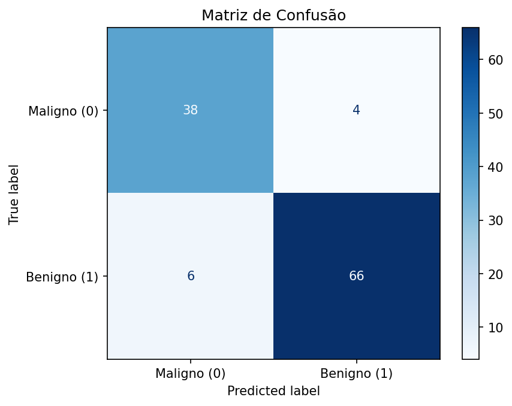
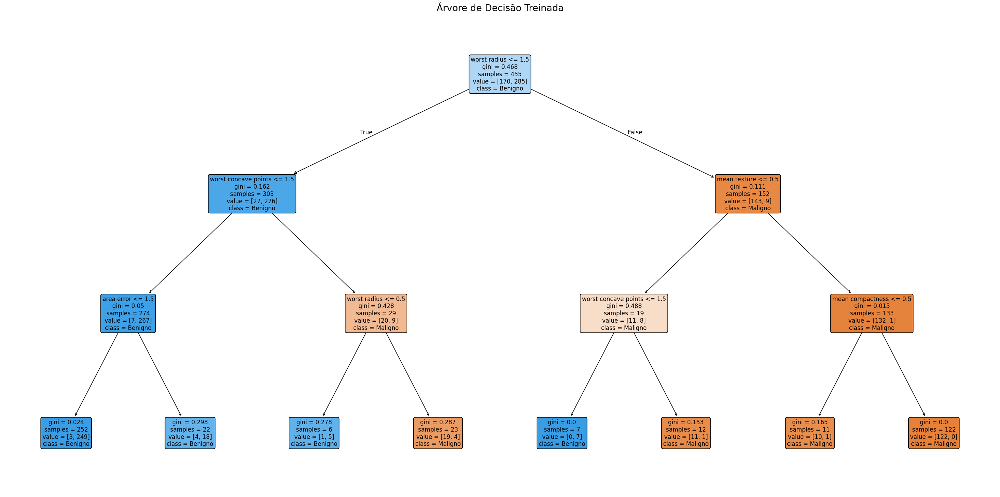

# Classificação de câncer de mama com árvore de decisão

Projeto acadêmico desenvolvido na disciplina **TN724 — Inteligência Artificial 2026.1**. O objetivo é construir um “sistema especialista do século XXI”: em vez de escrever regras manualmente, treinamos uma árvore de decisão e traduzimos as regras aprendidas para Prolog.

O [notebook](mama_cancer.ipynb) reúne a preparação dos dados, o treinamento, a avaliação e a geração das regras. O projeto demonstra classificação supervisionada, controle de vazamento de dados, interpretação de métricas e extração de regras.

**Finalidade acadêmica e de portfólio. Não é uma ferramenta de diagnóstico e não deve orientar decisões médicas.**

## Dados

Utilizamos o **Breast Cancer Wisconsin (Diagnostic)**, carregado por `load_breast_cancer` do scikit-learn:

- 569 amostras e 30 características numéricas extraídas de imagens de aspirados por agulha fina de massas mamárias.
- Classe **0 = maligno** (212 amostras); classe **1 = benigno** (357 amostras).
- Características de forma e tamanho dos núcleos celulares, com medidas de média, erro padrão e pior caso.

O dataset acompanha o scikit-learn; não é necessário baixar um CSV nem criar uma pasta de dados. Veja a [documentação do dataset](https://scikit-learn.org/stable/datasets/toy_dataset.html#breast-cancer-dataset).

## Metodologia

1. Separação estratificada: 80% para treino (455 amostras) e 20% para teste (114), com `random_state=42`.
2. Discretização por quantis em três faixas ordinais: baixo (0), médio (1) e alto (2), seguindo o objetivo do exercício.
3. `Pipeline` com `KBinsDiscretizer` e `DecisionTreeClassifier`: a discretização é ajustada somente no treino de cada fold, evitando vazamento na validação cruzada.
4. `GridSearchCV` com cinco folds e seleção pela acurácia, testando profundidades 3–6 e mínimos de 5, 10, 15 ou 20 amostras por folha.
5. Avaliação no teste separado, visualização da árvore, importância das características e geração automática de regras Prolog.

A melhor configuração foi `max_depth=3` e `min_samples_leaf=5`. Após a seleção, o Pipeline foi reajustado em todo o treino. O teste não foi usado para selecionar os hiperparâmetros. O método de quantil foi fixado em `linear` para tornar a escolha explícita.

## Resultados

Resultados recalculados com as versões de `requirements.txt` e Python 3.12:

| Métrica | Resultado |
| --- | ---: |
| Acurácia de treino | 96,92% |
| Média de acurácia na validação cruzada da configuração selecionada | 94,51% |
| Acurácia de teste | 91,23% |
| Precisão — benigno | 94,29% |
| Recall — benigno | 91,67% |
| F1-score — benigno | 92,96% |
| **Sensibilidade / recall — maligno** | **90,48%** |

A média da validação cruzada foi usada na seleção; não deve ser interpretada como uma avaliação independente da busca.

| Classe real / Predição | Maligno | Benigno |
| --- | ---: | ---: |
| Maligno | 38 | 4 |
| Benigno | 6 | 66 |

**4 dos 42 casos malignos foram classificados como benignos.** Esse erro fica menos evidente quando olhamos apenas a acurácia. No cálculo manual original, benigno é a classe positiva; para a sensibilidade de malignos, a classe de interesse é 0.



As maiores importâncias desta árvore foram de `worst radius` e `worst concave points`. Importância na árvore não demonstra causalidade ou relevância clínica por si só.



## Regras Prolog e limites da verificação

O notebook gera as regras a partir da árvore treinada e apresenta consultas sugeridas para cinco exemplos. Essas consultas recebem **valores discretizados**, não medidas numéricas originais.

O percurso manual da árvore em Python foi comparado com `predict`. **Isso não equivale a executar Prolog.** Não havia interpretador Prolog disponível no ambiente de revisão; portanto, o código gerado não foi validado nesse interpretador e não incluímos `prolog/regras.pl` como um artefato validado. As regras completas permanecem na saída do notebook, sem uma segunda cópia manual que possa ficar desatualizada.

## Limitações

- Dataset pequeno e de uma única origem; não houve validação externa nem avaliação clínica.
- Os resultados dependem da divisão de treino e teste. Não estimamos intervalos de confiança nem repetimos a avaliação em várias divisões.
- A discretização atende à proposta acadêmica e facilita a representação das regras, mas perde informação numérica.
- A busca priorizou acurácia; não foi otimizada especificamente para reduzir os erros da classe maligna.
- Não houve comparação sistemática com outros algoritmos. Os resultados não estabelecem superioridade do modelo.

## Arquivos

| Caminho | Conteúdo |
| --- | --- |
| `mama_cancer.ipynb` | Notebook principal com explicações, código e saídas recalculadas |
| `README.md` | Apresentação, resultados, limitações e instruções |
| `requirements.txt` | Dependências diretas com versões usadas na revisão |
| `.gitignore` | Exclusões de ambientes, caches e arquivos locais |
| `images/` | Matriz de confusão e árvore usadas neste README |

## Como executar

Use **Python 3.12**, versão utilizada na revisão. Na pasta do projeto, crie e ative um ambiente virtual:

```bash
python -m venv .venv
```

Linux/macOS:

```bash
source .venv/bin/activate
```

Windows (PowerShell):

```powershell
.venv\Scripts\Activate.ps1
```

Instale as dependências e abra o notebook:

```bash
python -m pip install -r requirements.txt
python -m notebook mama_cancer.ipynb
```

No Jupyter, reinicie o kernel e execute todas as células em ordem. Abra o notebook na raiz do projeto: as imagens em `images/` são atualizadas durante a execução. O dataset não exige conexão após a instalação das dependências.

Na revisão, todas as 13 células de código foram executadas sequencialmente em uma sessão IPython no mesmo processo, com saídas e gráficos regenerados. O ambiente não permitiu iniciar um kernel Jupyter separado. Também foram conferidos o recall maligno com a função do scikit-learn e a concordância entre o percurso manual e `predict` nas 114 amostras de teste. Essa verificação não inclui um interpretador Prolog.

## Autoria e contexto acadêmico

**Aluno:** Bruno Lima
**Professor:** Ronaldo e Silva Vieira.  
**Disciplina:** TN724 — Inteligência Artificial 2026.1.

Os créditos originais foram preservados. O material original não discrimina as contribuições individuais de cada integrante.

## Referências

- [Dataset Breast Cancer Wisconsin no scikit-learn](https://scikit-learn.org/stable/datasets/toy_dataset.html#breast-cancer-dataset).
- [Prevenção de vazamento de dados com Pipeline](https://scikit-learn.org/stable/common_pitfalls.html#data-leakage).
- [Discretização de variáveis contínuas](https://scikit-learn.org/stable/auto_examples/preprocessing/plot_discretization.html).

## Transparência sobre o uso de IA

O GPT foi usado para formatar, corrgir erros de gramática e melhorar a clareza da comunicação, além de avaliar possíveis erros metodológicos. A estrutura, as decisões tomadas e a forma de comunicação do notebook original foram preservadas sempre que possível.
